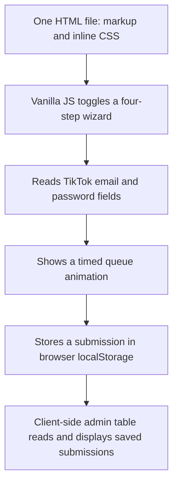

# REA reconnaissance: `lagoslife.app`

> **Attribution warning:** I could not verify that the public repository named [`lagoslifeapp/Lagoslife.app`](https://github.com/lagoslifeapp/Lagoslife.app) serves the live game. The checked-in page identifies itself as **“Buzzoid TikTok Booster”**, not Lagos Life. The findings below describe that repository snapshot only; they are not claims about the live game.

## What was analyzed

- **Source candidate:** [`lagoslifeapp/Lagoslife.app` at commit `06fdb36139e909223a39ddebdd4b31890a7f5948`](https://github.com/lagoslifeapp/Lagoslife.app/tree/06fdb36139e909223a39ddebdd4b31890a7f5948)
- **Contents at that revision:** one tracked file, [`index.html`](https://github.com/lagoslifeapp/Lagoslife.app/blob/06fdb36139e909223a39ddebdd4b31890a7f5948/index.html), 25,301 bytes.
- **Analyzer:** [REA](https://github.com/morluto/rea) CLI `rea-agents@6.5.0`.
- **Method:** static analysis only. The page was not launched and its JavaScript was not executed.
- **REA HTML-pass evidence:** `ev_c6eea99ec1b24f01e04a5b5f1341bc576c34524eb322d61e467159ec42d2d781`; `index.html` SHA-256 `6d0fe6ccc0e16e5758f2cd29eb17f8371daa4daf3fc78c4e9568dc97704d41a3`.
- **REA JavaScript-pass evidence:** `ev_2ba849f4697b65c73ffdef258ec607a50aad42347bccda68ab6f5f08339c29d2` for the extracted inline JavaScript; analyzed asset SHA-256 `f6b375fdd2e3f61d200c7dca4e7379066fcb8abec9cd60f9162edfca757909eb`.

REA’s first pass over the HTML correctly reported that its one inline `<script>` block had not been analyzed. I extracted that block as inert text into a temporary `.js` file and reran REA against it; no app code was run. The successful JavaScript pass parsed one file (942 AST nodes) and reported three storage operations for `localStorage` (`getItem`, `setItem`, `removeItem`).

Reproduce the first pass after cloning the candidate repository with:

```bash
npx --yes rea-agents@latest analyze-javascript-application ./Lagoslife.app --format json --full-output
```

The inline-script limitation is important: an HTML-only pass is not evidence that the inline JavaScript has no behavior.

## What this source snapshot appears to be

The page is a single-file HTML/CSS/vanilla-JavaScript wizard, not a game engine or game loop. Its title and header say “Buzzoid TikTok Booster” ([title/header](https://github.com/lagoslifeapp/Lagoslife.app/blob/06fdb36139e909223a39ddebdd4b31890a7f5948/index.html#L6-L7), [header](https://github.com/lagoslifeapp/Lagoslife.app/blob/06fdb36139e909223a39ddebdd4b31890a7f5948/index.html#L103-L107)). The UI has four steps: choose a service, choose a quantity, enter account details, and review/submit ([wizard](https://github.com/lagoslifeapp/Lagoslife.app/blob/06fdb36139e909223a39ddebdd4b31890a7f5948/index.html#L121-L225)).



Source references for that flow:

1. `nextStep`, `selectService`, and `selectQuantity` keep the selection in page-level variables and change DOM classes ([JS](https://github.com/lagoslifeapp/Lagoslife.app/blob/06fdb36139e909223a39ddebdd4b31890a7f5948/index.html#L337-L364)).
2. The account fields are plain text inputs, including the field labelled “TikTok password” ([HTML](https://github.com/lagoslifeapp/Lagoslife.app/blob/06fdb36139e909223a39ddebdd4b31890a7f5948/index.html#L184-L200)). `validateAndReview` copies both values into the review panel ([JS](https://github.com/lagoslifeapp/Lagoslife.app/blob/06fdb36139e909223a39ddebdd4b31890a7f5948/index.html#L366-L382)).
3. `submitRequest` displays progress messages on a timer, builds a record containing the submitted `user` and `pass`, then writes the records to the `buzzoid_leads` local-storage key ([JS](https://github.com/lagoslifeapp/Lagoslife.app/blob/06fdb36139e909223a39ddebdd4b31890a7f5948/index.html#L384-L424)).
4. A hidden three-click footer trigger opens a client-side admin panel ([JS](https://github.com/lagoslifeapp/Lagoslife.app/blob/06fdb36139e909223a39ddebdd4b31890a7f5948/index.html#L292-L303)). The table renders stored user/password values into `innerHTML` ([JS](https://github.com/lagoslifeapp/Lagoslife.app/blob/06fdb36139e909223a39ddebdd4b31890a7f5948/index.html#L452-L473)).
5. A small Web Audio oscillator supplies click sounds; it is not gameplay audio ([JS](https://github.com/lagoslifeapp/Lagoslife.app/blob/06fdb36139e909223a39ddebdd4b31890a7f5948/index.html#L312-L335)).

### Safety note

This snapshot asks for TikTok account credentials, saves them in browser storage, and exposes them in an admin viewer. **Do not enter real credentials into this page.** The checked-in file contains no visible `fetch`, XHR, WebSocket, or external script call, so this static snapshot alone does not show a server-side exfiltration path. That does not authenticate the live site or rule out different deployed code, other versions, or hosting-side behavior.

## What this does—and does not—tell us about Lagos Life

It tells us how the *candidate repository* is structured: one HTML page, inline styles, vanilla JavaScript, browser-local state, and a form-style flow. The source does **not** show a Lagos city-life game, player movement, a world renderer, a game loop, game assets, or game-specific backend logic. There is no evidence here that this commit is the code deployed at `lagoslife.app`.

To explain the actual game accurately, I need either the correct source repository or REA captures from the live page. A live capture will let me trace the loaded scripts/modules and observed network surface; a short list of ordinary gameplay actions will help identify which code paths implement the game. A capture can still leave server-side behavior or obfuscated code unresolved.

## Capturing the live page with REA

On your own machine, use a **separate, empty browser profile** and keep Chrome’s DevTools endpoint on loopback. Do not use a logged-in personal profile or enter account secrets while capturing.

```bash
# Start Chrome/Chromium with a dedicated profile and local-only CDP.
google-chrome \
  --remote-debugging-port=9222 \
  --user-data-dir=/tmp/rea-lagoslife-profile \
  'https://lagoslife.app'

# List the page target, then replace TARGET_ID with the returned ID.
npx --yes rea-agents@latest list-browser-targets \
  http://127.0.0.1:9222 \
  --allowed-origins 'https://lagoslife.app' --format json

npx --yes rea-agents@latest inspect-web-page \
  http://127.0.0.1:9222 TARGET_ID \
  --allowed-origins 'https://lagoslife.app' \
  --include-script-sources --include-accessibility-text --include-storage-keys \
  --format json > lagoslife-page-evidence.json

npx --yes rea-agents@latest analyze-web-bundle \
  http://127.0.0.1:9222 TARGET_ID \
  --allowed-origins 'https://lagoslife.app' --fetch-source-maps \
  --format json > lagoslife-bundle-evidence.json
```

Use the exact origin shown after the browser finishes any redirects if it differs from `https://lagoslife.app`. Keep the debugging port private and stop the dedicated browser when finished. Share the two JSON evidence files (and a short, non-sensitive list of game actions) to continue the analysis.
